# dotfiles

**Arch Linux · niri · Wayland · Tokyo Night**

A scrolling-tiling desktop built around [niri](https://github.com/YaLTeR/niri), with a two-bar
[Waybar](https://github.com/Alexays/Waybar) setup that doubles as a homelab dashboard, a
macOS-style notification center, and one consistent Tokyo Night look across everything.

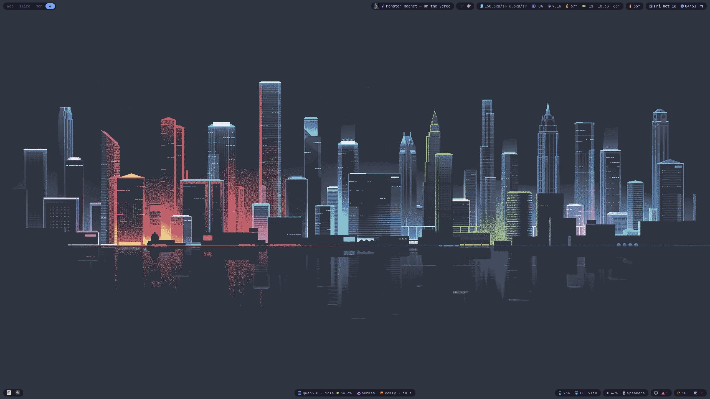

<p align="center"><sub>One of three 27" 1440p monitors. Every bar, panel and menu shares the same palette, font and rounded-card style.</sub></p>

## In use

All three monitors on a normal day. Private content (chat messages, file names, browser tabs, the terminal) is blurred.

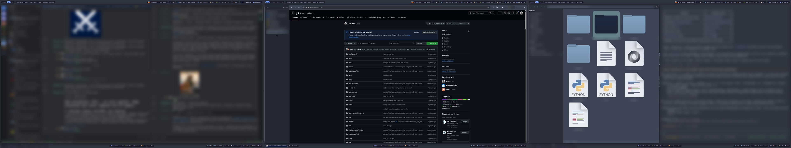

| Left: chat | Centre: browser | Right: files and terminal |
|---|---|---|
| 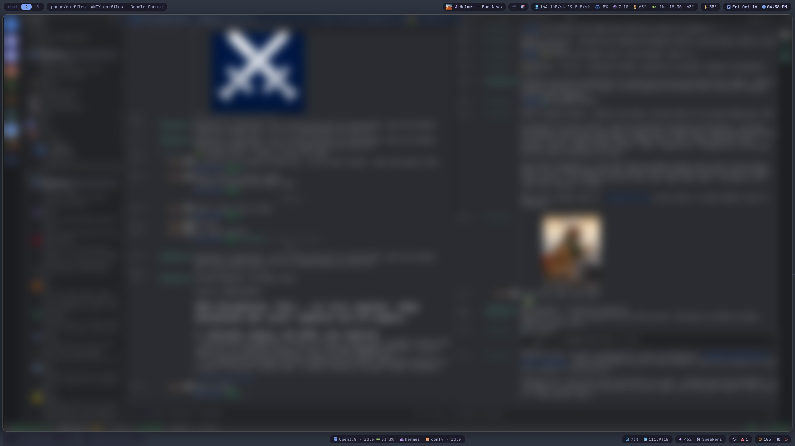 | 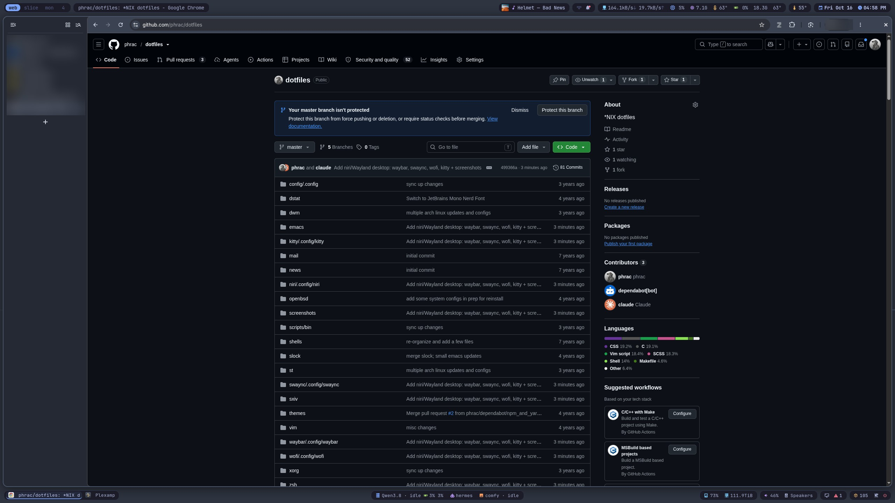 | 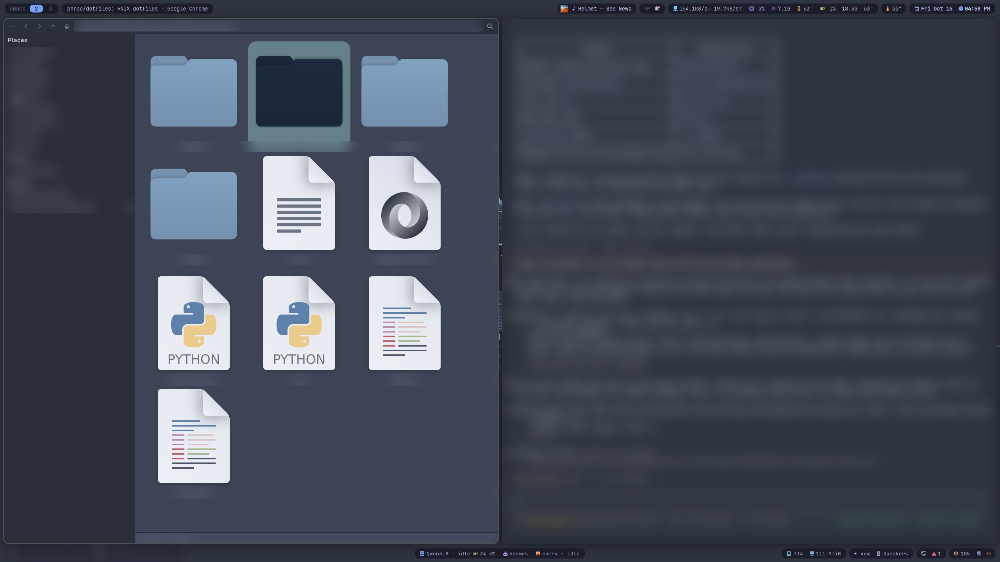 |

**Notification center over real work.** <kbd>Super</kbd>+<kbd>N</kbd> opens it on whichever monitor has focus.

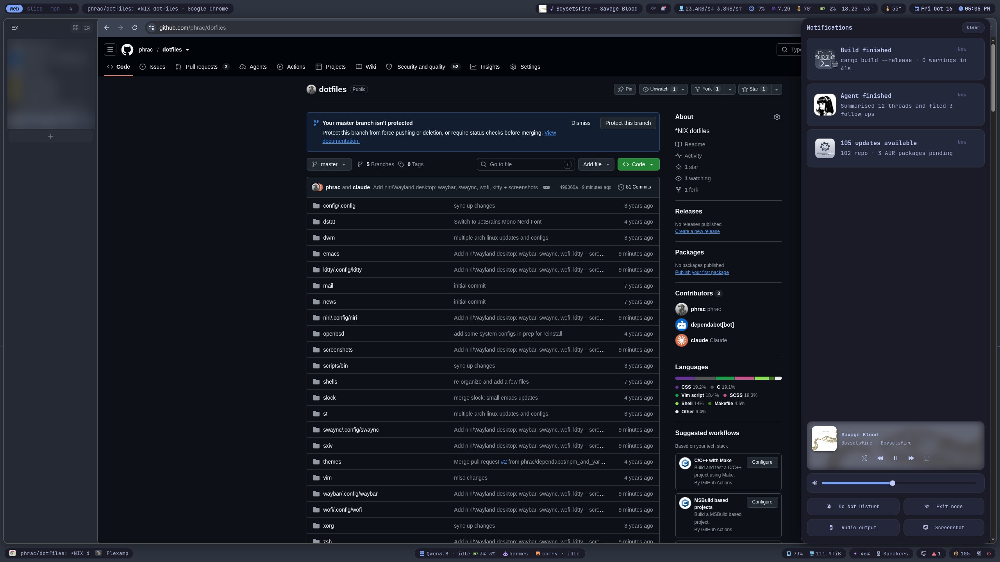

**Hover anything for details.** Here, GPU load, VRAM, temperatures, power, fan and clocks:

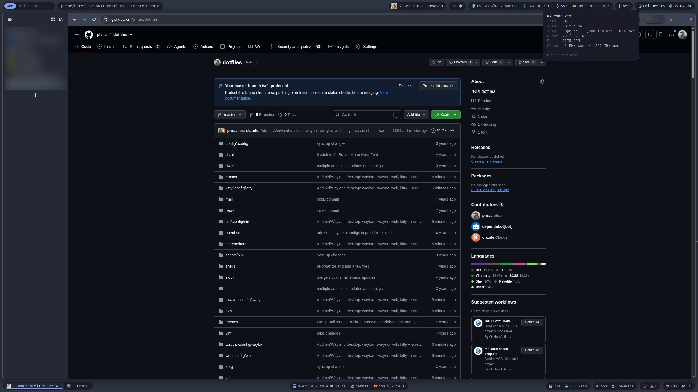

**Tooltips.** Calendar, GPU, memory and CPU temperature on the top row; Now Playing, volume, audio output and disk in the middle; the LLM server, agent, system health and pending updates at the bottom. The hostnames in the LLM and agent tooltips are blurred.

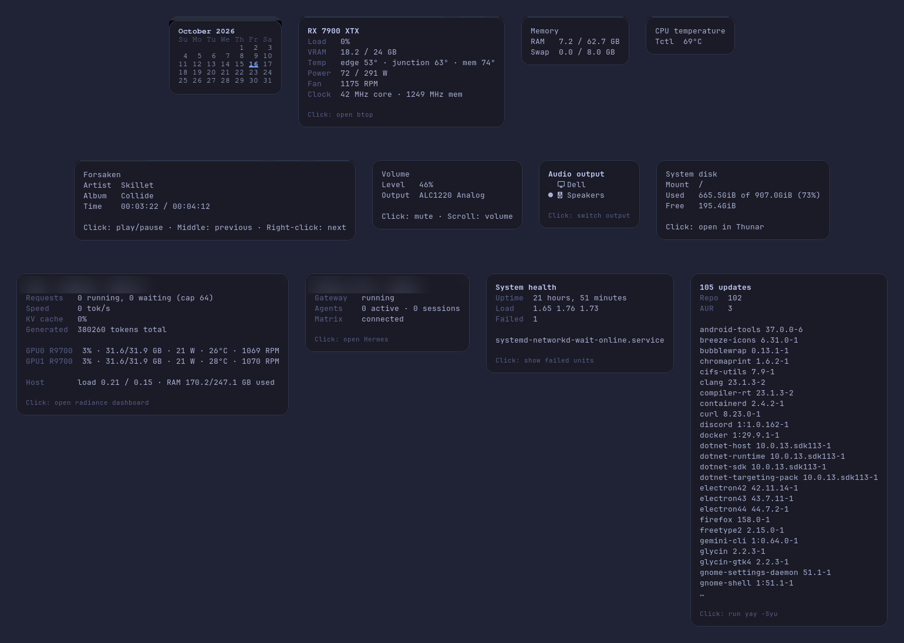

---

## Highlights

- **niri**: scrollable tiling, named workspaces pinned per monitor, triple-monitor layout.
- **Top bar**: workspaces, window title, now playing with album art, Tailscale exit-node toggle, notifications, network, CPU, RAM, CPU and GPU temperature, local weather and date/clock.
- **Bottom bar**: a homelab and system dashboard. It has a window taskbar, live LLM-server stats (tokens/s, queue, per-GPU load), agent and ComfyUI status, disks and NAS, audio output switching, screenshots, failed-unit health, pending updates, the tray and a power menu.
- **Notification center**: swaync restyled after macOS. It has cards with a hover-only close button, a Now Playing widget, a volume slider and quick-toggle tiles. It opens with <kbd>Super</kbd>+<kbd>N</kbd>.
- **Themed tooltips**: every tooltip is a small card with a title, aligned labels and click hints. For the script modules, one `jq` filter adds a bold title, dim labels and small hints.
- **One theme everywhere**: Waybar, swaync, the wofi launcher and menus, and kitty all use Tokyo Night and JetBrains Mono Nerd Font.

## Gallery

| Notification center | Pop-up notifications |
|---|---|
| 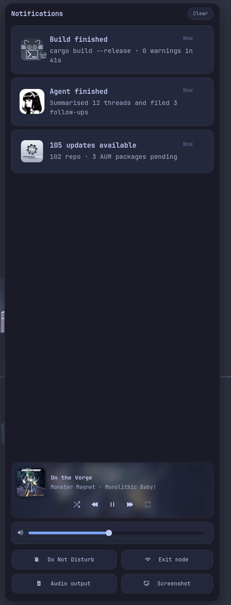 | 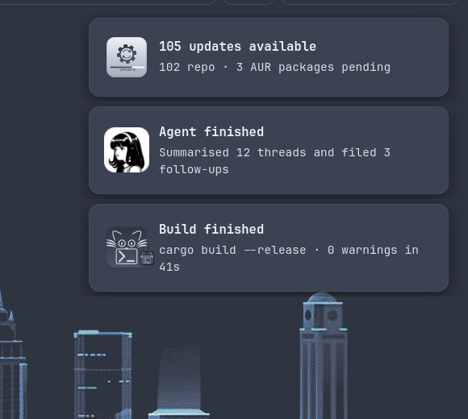 |

| Launcher (wofi) | Power menu |
|---|---|
| 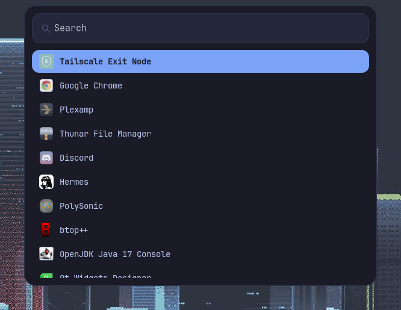 | 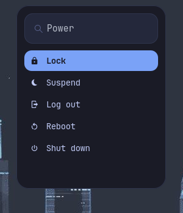 |

**Top bar**


**Bottom bar**

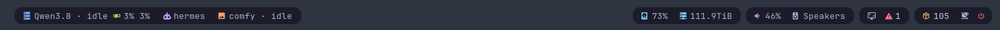

**All three monitors**

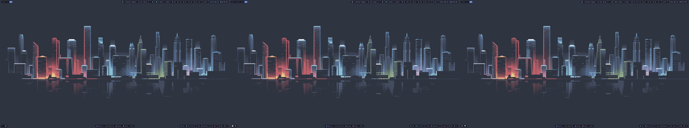

**Notification center, full screen**

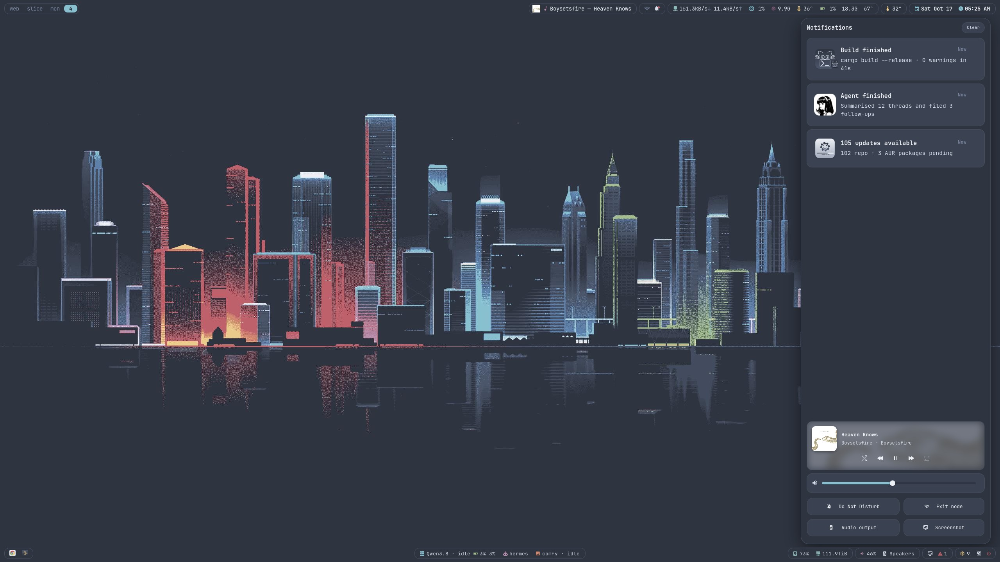

---

## What's inside

| Package | Path | What it is |
|---|---|---|
| `niri` | `~/.config/niri/config.kdl` | Compositor: outputs, named workspaces, keybinds, startup apps |
| `waybar` | `~/.config/waybar/` | Both bars (one process), stylesheet, status scripts |
| `swaync` | `~/.config/swaync/` | Notification daemon and macOS-style control panel |
| `wofi` | `~/.config/wofi/` | Launcher theme, shared with the bars' menus |
| `kitty` | `~/.config/kitty/` | Terminal |
| `zsh` | `~/.zshrc` | Shell (oh-my-zsh) |
| `emacs` | `~/.doom.d/` | Doom Emacs |

### Waybar scripts

All of them live in `waybar/.config/waybar/scripts/`. They print Waybar JSON, and their output goes through `tip.jq` to get the themed tooltips.

| Script | Shows |
|---|---|
| `tailscale-exit` | Exit-node status. Click toggles it (it remembers the last node), right-click picks a node |
| `weather` | Current conditions from a Wunderground **personal weather station** |
| `gpu` | AMD GPU load, VRAM and junction temperature from sysfs. No ROCm tools needed |
| `llm` | A remote vLLM-compatible server (tokens/s, requests, KV cache) plus per-GPU stats from an amdgpu Prometheus exporter |
| `hermes` | Hermes agent gateway status |
| `comfy` | Local ComfyUI queue |
| `updates` | Pending pacman and AUR updates. Click runs `yay -Syu` |
| `sink` | Current audio output. Click switches to the next one and moves playing streams |
| `health` | Failed systemd units (system and user), uptime and load |
| `power` | wofi power menu |
| `plexamp-art` | Album art for the Now Playing module |
| `tip.jq` | Turns plain-text tooltips into Pango markup that matches the theme |

Scripts that run once per monitor (`llm`, `updates`) take turns with `flock` and share a short-lived result. That way three monitors don't triple the requests or trip over pacman's lock.

## Install

Everything is a [GNU stow](https://www.gnu.org/software/stow/) package:

```sh
git clone https://github.com/phrac/dotfiles ~/dotfiles
cd ~/dotfiles
stow niri waybar swaync wofi kitty zsh
```

If a config file already exists, stow refuses to overwrite it. Move the file out of the way first, or run `stow --adopt` and then use `git diff` to review what it pulled in.

Dependencies (Arch):

```sh
sudo pacman -S niri waybar swaync wofi kitty swaybg swaylock swayidle \
  jq curl playerctl pacman-contrib wireplumber pipewire-pulse \
  ttf-jetbrains-mono-nerd thunar btop
yay -S nordzy-icon-theme   # taskbar and launcher icons
```

Enable the notification daemon as a user service. niri starts Waybar itself.

```sh
systemctl --user enable --now swaync
```

### Make it yours

Personal hosts and IDs are replaced with placeholders. Set these before you use them:

| Where | Placeholder | Set it to |
|---|---|---|
| `scripts/weather`, `config.jsonc` | `YOUR_STATION_ID` | Your Wunderground PWS ID. Put your API key in `~/.config/waybar/wunderground.key` (gitignored) |
| `scripts/tailscale-exit` | `my-exit-node` | Your usual Tailscale exit node |
| `scripts/llm`, `config.jsonc` | `llm-host` | The machine running your LLM server |
| `scripts/hermes`, `config.jsonc` | `agent-host` | The machine running Hermes |
| `scripts/gpu` | `dev=/sys/devices/...` | Your GPU's PCI path (`readlink -f /sys/class/drm/card*/device`) |
| `config.jsonc` | `/mnt/nas` | Your NAS mount |
| `niri/config.kdl`, `swaync/config.json` | `DP-1`/`DP-2`/`DP-3` | Your outputs (`niri msg outputs`). Pop-ups are pinned to the right monitor |

If you don't run some of these services, drop the matching module from `config.jsonc`.

## Keybinds

| Keys | Action |
|---|---|
| <kbd>Super</kbd>+<kbd>Return</kbd> | Terminal (kitty) |
| <kbd>Super</kbd>+<kbd>Space</kbd> | Launcher (wofi) |
| <kbd>Super</kbd>+<kbd>N</kbd> | Notification center |
| <kbd>Super</kbd>+<kbd>B</kbd> | Show/hide both bars |
| <kbd>Super</kbd>+<kbd>O</kbd> | Overview |
| <kbd>Super</kbd>+<kbd>F</kbd> | Maximize column |
| <kbd>Super</kbd>+<kbd>Q</kbd> | Close window |
| <kbd>Super</kbd>+<kbd>Shift</kbd>+<kbd>/</kbd> | All keybinds |

## Notes

- **One Waybar process for both bars.** `config.jsonc` is an array holding the top and bottom bars. With two separate Waybar processes, a reload (`SIGUSR2`) aborts one of them in GLib's D-Bus code.
- **Some tooltips can't be styled.** Waybar shows the `cpu`, `memory`, `temperature`, `disk`, `mpris`, `wireplumber` and `wlr/taskbar` tooltips as plain text, so Pango markup there appears as raw `<span>` tags. Those modules use the same layout in plain text. Custom modules and `clock` render markup, and the notification module must not set `"escape": true`, because `tip.jq` already escapes.
- **swaync replaces mako.** Only one notification daemon can own `org.freedesktop.Notifications`.
- Waybar runs each module once per monitor. Anything that keeps state (tokens/s deltas, `checkupdates`) needs the take-turns-and-share-the-result pattern described above.

---

## Legacy: OpenBSD / dwm era

Everything else in this repo (`dwm`, `st`, `slock`, `dstat`, `xorg`, `openbsd`, `mail`, `news`, `vim`, …)
is my older X11 setup on OpenBSD, kept for reference. Stow those packages the same way.

<details>
<summary>Screenshots (ca. 2020)</summary>


…and Doom Emacs


</details>
